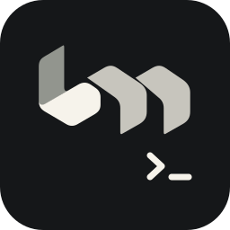

# LMM provider for DSH

Account models, cached models.dev metadata and server prices: [dynamic catalog](DYNAMIC_CATALOG.md).



Use the models available to your [LMM](https://api.lmm.best) account directly in DeepSeek Harness. Authentication uses browser OAuth with PKCE and a loopback callback. No API key is pasted into DSH.

The current source tree is tested with the actual DSH Web host `0.2.0-rc.2`, `0.2.1-alpha.1`, `0.2.1-alpha.2` and `0.2.2-rc.1` (the current npm `latest`). This is a tested baseline, not an upper version limit. DSH prereleases require explicit npm semver admission. The alpha host is tested with its matching service packages and Cordis peer; normal installation remains on the official latest tag. The current maintenance fixture uses the coherent `0.2.2-rc.1` service cohort, Cordis `4.1.0` and pi-ai `1.5.2`; React stays on the host's 18.x line. The DSH host owns the pi-ai dependency: earlier releases use its 0.87 line, while `0.2.1-alpha.2` uses 1.x. The plugin uses the matching host SDK rather than installing a conflicting second copy. Older Desktop `0.1.7-alpha.2` can use plugin `0.1.0-alpha.4`. It requires Node.js `22.19.0` or newer in the supported Node 22 / Node 24+ lines. For DSH `0.1.5-rc.2`, use plugin `0.1.0-alpha.3` instead; the DSH runtime packages are not interchangeable between those releases.

## Model discovery

The authenticated LMM catalog determines the complete available model list. The nested Pi adapter fills missing limits and capabilities from the full [models.dev API](https://models.dev/api.json?type=all), with automatic local caching and fuzzy name matching. There is no provider-name or model-ID allowlist. Unknown compatible models remain selectable with labeled generic limits and unknown-price indicators. Explicit server fields and account prices take priority; public metadata never changes the authorized model/group ID.

## Official DSH Desktop

On a current official DSH Desktop using DSH `0.2.0-rc.2` or newer, open **Plugins** and add the current LMM plugin. For Desktop `0.1.7-alpha.2`, use `@tokennotincluded/dsh-lmm-provider@0.1.0-alpha.4`. The official Desktop application owns an isolated `desktop` profile; installing into a CLI `web` profile does not install the plugin in Desktop. If an older local, Git or release archive copy of this package is already installed, remove that package in Desktop Plugins first, then add the built release package. The Desktop manager permits one dependency with this package name per profile, so two sources cannot run together there. Restart Desktop if the manager asks for it.

In **Settings → Models**, choose **Sign in with LMM**. Use **Open LMM authorization** if it opens your normal browser. If the link does nothing or opens a browser without your LMM login, choose **Copy link** and paste it into the browser where you are already signed in. On the LMM authorization page, choose **Continue** when already signed in. The **Sign in** link is for a browser without an active LMM session. Review the account and permissions, choose **Allow access**, and wait for DSH to show **Sign-in complete**. If the browser does not return to DSH automatically, use **Return to DSH** on the completion page.

Keep Desktop open throughout the attempt. The authorization link is short lived and tied to the local callback listener, so start a fresh attempt if it expires. A failed attempt now shows a credential-free reason in the card.

## DSH CLI / Web profile

Install the current built release in the profile you run:

```sh
dsh plugin --profile web add https://github.com/TokenNotIncluded/dsh-lmm-provider/releases/download/v0.1.0-alpha.8/dsh-lmm-provider.tgz --ignore-scripts
```

For future updates, choose the newest built asset from [GitHub Releases](https://github.com/TokenNotIncluded/dsh-lmm-provider/releases/latest). The LMM DSH installation scripts resolve that current release automatically and keep the official host on npm `latest`. The DSH package manager also keys this dependency by package name. To switch from a local, Git or archive installation, remove `@tokennotincluded/dsh-lmm-provider` from that profile, then add the built release package. Credential records are stored separately from the package dependency.

### Install from source

```sh
npm install -g @deepseek-ai/dsh@latest
git clone --recurse-submodules https://github.com/TokenNotIncluded/dsh-lmm-provider.git
cd dsh-lmm-provider
npm ci
npm run build
dsh plugin --profile web add .
```

The submodule is required by the build. If the repository was cloned without it, run `git submodule update --init --recursive` before building. Keep the checkout after installation: DSH links local plugin directories.

The bundle includes the authorization service and the Web Models-page login card. Install it separately in each profile that needs LMM. A headless profile can use the credential after a Web login when both profiles share the same `DSH_HOME`:

```sh
dsh plugin --profile headless add /absolute/path/to/dsh-lmm-provider
```

## Sign in from the Web profile

1. Switch to your project directory, start `dsh web`, and open Settings → Models.
2. Find the **LMM** card and select **Sign in with LMM**.
3. Open the authorization link in the browser where you are signed in to LMM. Click **Continue** on the LMM page, review and approve access, then return to DSH.
4. The card reports **Sign-in complete** only after DSH observes the saved credential. Select an LMM model in your conversation.

Cancel keeps tracking the pending login until the host finishes cancellation. Closing Settings also cancels that page's active attempt, including a login that is still starting. A sign-in attempt expires after five minutes. Prompt answers and OAuth credentials are never returned in status responses. The Web controls use DSH's existing authenticated API transport and its Host/Origin checks.

**Sign out** removes the local credential. It does not revoke the server grant; revoke the authorization in your LMM account when needed. Model access, groups, capabilities, and prices come from the account-scoped LMM catalog. Token refresh is serialized by DSH and additionally fenced by a credential-free refresh journal under `DSH_HOME`.

## Development

```sh
npm ci
npm test
npm run typecheck
npm run pack:check
npm run test:host
```

The package ships both the Host adapter and the browser bundle. Tests cover credential isolation, OAuth client identity, loader dependency metadata, authorization prompts, cancellation, and secret-free responses. A successful build or installation alone is not proof of live OAuth and model invocation; verify those against an authorized test account before relying on a new release.

`test:host` launches the official DSH Web process in a temporary home with the built plugin, checks its authenticated Connection routes, drives browser OAuth PKCE through a local fixture, verifies the durable credential and account catalog, streams a model response through the real DSH adapter, then signs out. The LMM network is intercepted by a test-only preload; no production grant or billable call is made. CI runs the baseline and current official npm host.

LMM model requests carry DSH's conversation session ID as gateway affinity headers when the transport supports them. Credential updates invalidate the catalog even when discovery is already running. Automatic model-request retries are disabled at both the SDK and DSH host levels: a timeout, empty response, or lost connection may already have incurred a charge, so retry manually after checking the result.

### Shared runtime dependency rule

DSH authorization, home paths, the pi-ai adapter and the pi-ai SDK itself are host-owned peer dependencies. Installing a second independently selected copy can shadow the active runtime and make stable DSH disable its authorization/model services. Development pins remain on the stable host, and the CI matrix verifies source plus tarball installation on each supported host. Do not use `allow-version` or disable the host compatibility checks to work around a dependency mismatch.
